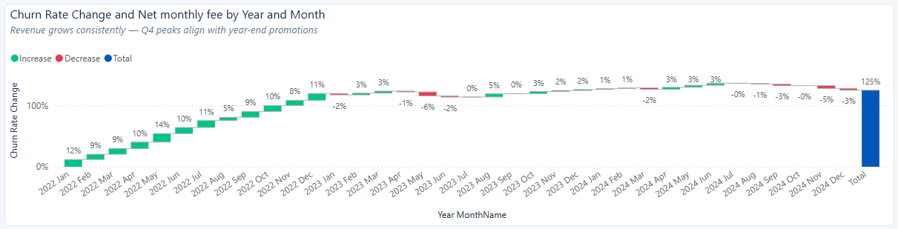
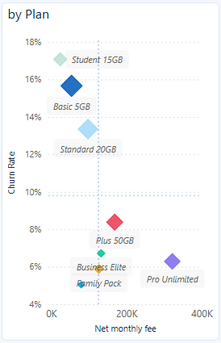
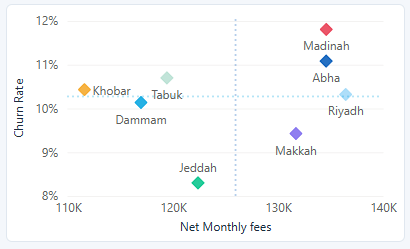
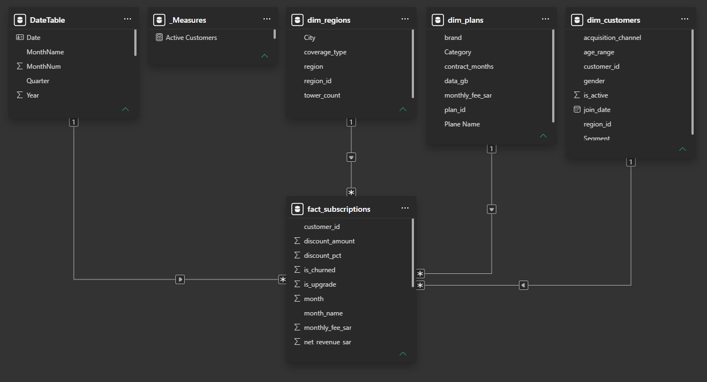

 

<h1 align=middle> WAVE Telecom-Portfolio </h1>

Subscription &amp; Churn Dashboard &mdash; Junior-Level Business Analysis &nbsp;Power BI | Simulated Saudi telecom data | January 2022&ndash;December 2024

<h2>Introduction </h2>
WAVE Telecom is a fictional Saudi telecommunications operator used in this project to explore subscription performance, customer retention, and regional business trends through data analysis. Using simulated data from January 2022 to December 2024, this Power BI dashboard examines how subscription plans and customer segments contribute to monthly-fee value, where subscription churn is most prominent, and how performance varies across cities.
The dashboard brings these perspectives together to help identify performance patterns, highlight potential retention priorities, and support more informed business decisions. Its findings provide a starting point for investigating subscription growth and retention opportunities across WAVE Telecom.

<h2>Report objectives</h2>

The analysis focuses on four key business questions:
-	Plan Performance: Which subscription categories and plans contribute the most monthly-fee value, and which experience the highest subscription churn?
-	Customer Retention: Which customer segments show the greatest retention challenges, and where could targeted retention efforts be most useful?
-	Time Trends: How has the monthly-fee value associated with new subscriptions changed over the three-year period?
-	Regional Performance: Which cities have the strongest subscription performance, and where do differences in churn and support activity warrant further investigation?

  
<table align="center">
	<tbody>
		<tr>
			<td>
<strong> Metric </strong>
</td>
			<td>
<strong> Result </strong>
</td>
			<td>
<strong> Interpretation </strong>
</td>
		</tr>
		<tr>
			<td>
<strong> Subscription records </strong>
</td>
			<td>
6,248
</td>
			<td>
Unique subscription records in the fact table.
</td>
		</tr>
		<tr>
			<td>
<strong> Customers represented </strong>
</td>
			<td>
2,617
</td>
			<td>
Distinct customers appearing in the fact table; customers may have multiple subscriptions.
</td>
		</tr>
		<tr>
			<td>
<strong> Sum of net monthly fee values </strong>
</td>
			<td>
SAR 1,007,656.45
</td>
			<td>
Sum of subscription-level net monthly fees across records, not recognized accounting revenue.
</td>
		</tr>
		<tr>
			<td>
<strong> Subscription-level churn rate </strong>
</td>
			<td>
10.3%
</td>
			<td>
643 churned subscription records / 6,248 subscription records.
</td>
		</tr>
		<tr>
			<td>
<strong> Support tickets </strong>
</td>
			<td>
3,787
</td>
			<td>
Total support-ticket counts recorded across subscription rows.
</td>
		</tr>
		<tr>
			<td>
<strong> Upgrade records </strong>
</td>
			<td>
684
</td>
			<td>
Subscription records flagged as upgrades.
</td>
		</tr>
	</tbody>
</table>

---
<h2>1. Executive summary</h2>

The dataset contains 6,248 subscription records, 3,000 customer records, 8 plans and 8 regional records. 
The sum of net monthly fees associated with the subscription records is SAR 1,007,656.45.  
Postpaid has the largest total monthly-fee value in the category.
while the strongest subscription-level retention concern is concentrated in Prepaid plans and Student/Individual customer segments. 
City results are relatively close in revenue, but Madinah has the highest observed city subscription-level churn rate.

---
<h2>2. Subscription cohort fee-value trend</h2>

<table>
	<tbody>
		<tr>
			<td>  
<strong> Subscription start year </strong>
 </td>
			<td>  
<strong> Records </strong>
	</td>
			<td>	
<strong> Net monthly-fee value (SAR) </strong>
	</td>
			<td>	
<strong> Change vs prior year </strong>
 </td>
			<td>	
<strong> Record-count change </strong>
	</td>
		</tr>
		<tr>
			<td>	
<strong> 2022 </strong>
	</td>
			<td>	
 1,631 
  </td>
			<td>	
 264,467.95 
	</td>
			<td>	
  
 </td>
			<td>	
  
	</td>
		</tr>
		<tr>
			<td>	
<strong> 2023 </strong>
</td>
			<td>	
 2,178 
	</td>
			<td>	
 346,943.95 
	</td>
			<td>	
 +31.2% 
	</td>
			<td>	
 +33.5% 
 </td>
		</tr>
		<tr>
			<td>	
<strong> 2024 </strong>
	</td>
			<td>	
 2,439 
	</td>
			<td>	
 396,244.55 
	</td>
			<td>	
 +14.2% 
	</td>
			<td>	
 +12.0% 
	</td>
		</tr>
	</tbody>
</table>

   
> The total net monthly-fee value associated with subscriptions created in 2023 and 2024 is higher than in 2022, The highest year-quarter cohort fee-value total is 2024 Q4 (SAR 113,144), followed by 2024 Q3 (SAR 111,550), but the year-over-year growth rate slowed in 2024.

---
<h2>3. Plan category performance [plan + segments image]</h2>

<table>
	<tbody>
		<tr>
			<td>
<strong> Category </strong>
</td>
			<td>
<strong> Records </strong>
</td>
			<td>
<strong> Net monthly-fee value (SAR) </strong>
</td>
			<td>
<strong> Net monthly-fee value % </strong>
</td>
			<td>
<strong> Churned subscriptions </strong>
</td>
			<td>
<strong> Subscription churn rate </strong>
</td>
		</tr>
		<tr>
			<td>
<strong> Postpaid </strong>
</td>
			<td>
3,086
</td>
			<td>
617,890.10
</td>
			<td>
61%
</td>
			<td>
217
</td>
			<td>
7.0%
</td>
		</tr>
		<tr>
			<td>
<strong> Prepaid </strong>
</td>
			<td>
2,671
</td>
			<td>
176,790.30
</td>
			<td>
18%
</td>
			<td>
397
</td>
			<td>
14.9%
</td>
		</tr>
		<tr>
			<td>
<strong> Business </strong>
</td>
			<td>
491
</td>
			<td>
212,976.05
</td>
			<td>
21%
</td>
			<td>
29
</td>
			<td>
5.9%
</td>
		</tr>
	</tbody>
</table>

> Postpaid contributes the largest fee value across the subscriptions in the dataset (about 61%). Prepaid has the highest subscription churn rate (14.9%) and the largest number of churned subscription records (397). This makes Prepaid a sensible retention-investigation priority. 

<table>
	<tbody>
		<tr>
			<td>
				
<strong> Plan </strong>

			</td>
			<td>
				
<strong> Net monthly-fee value (SAR) </strong>

			</td>
			<td>
				
<strong> Subscription churn rate </strong>

			</td>
			<td>
				
<strong> Practical read </strong>

			</td>
		</tr>
		<tr>
			<td>
				
<strong> Pro Unlimited </strong>

			</td>
			<td>
				
322,088.50

			</td>
			<td>
				
6.3%

			</td>
			<td>
				
Largest plan fee-value contribution.

			</td>
		</tr>
		<tr>
			<td>
				
<strong> Plus 50GB </strong>

			</td>
			<td>
				
169,025.60

			</td>
			<td>
				
8.4%

			</td>
			<td>
				
High fee-value contribution; 
           monitor retention.

			</td>
		</tr>
		<tr>
			<td>
				
<strong> Basic 5GB </strong>

			</td>
			<td>
				
54,397.35

			</td>
			<td>
				
15.7%

			</td>
			<td>
				
Higher churn; 
           investigate plan fit and perceived value.

			</td>
		</tr>
		<tr>
			<td>
				
<strong> Student 15GB </strong>

			</td>
			<td>
				
24,363.90

			</td>
			<td>
				
17.1%

			</td>
			<td>
				
Highest observed plan churn rate; 
           investigate student needs and affordability.

			</td>
		</tr>
	</tbody>
</table>

---
<h2>4. Customer segments</h2>
Segment	Records	Net monthly-fee value (SAR)	Subscription churn rate

<table>
	<tbody>
		<tr>
			<td>			
<strong>Segment</strong>
			</td>
			<td>				
<strong>Records</strong>
			</td>
			<td>				
<strong>Net monthly-fee value (SAR)</strong>
			</td>
			<td>				
<strong>Subscription churn rate</strong>
</td>
		</tr>
		<tr>
			<td>				
<strong>Individual</strong>
			</td>
			<td>				
3,074
			</td>
			<td>				
381,384.50
			</td>
			<td>				
10.8%
			</td>
		</tr>
		<tr>
			<td>				
<strong>Family</strong>
			</td>
			<td>				
1,278
			</td>
			<td>				
277,452.90
			</td>
			<td>				
6.3%
			</td>
		</tr>
		<tr>
			<td>				
<strong>Business</strong>
			</td>
			<td>				
770
			</td>
			<td>				
274,645.75
			</td>
			<td>				
5.3%
			</td>
		</tr>
		<tr>
			<td>				
<strong>Student</strong>
			</td>
			<td>				
1,126
			</td>
			<td>				
74,173.30
			</td>
			<td>				
16.8%
			</td>
		</tr>
	</tbody>
</table>

> Student subscriptions have the highest observed churn rate (16.8%), followed by Individual subscriptions (10.8%). Family and Business subscriptions have lower rates.

---
<h2>5. Regional performance[cluster]</h2>

<table>
    <tbody>
        <tr>
            <td>
<strong> City </strong>
 </td>
            <td>
<strong> Records </strong>
 </td>
            <td>
<strong> Net monthly-fee value (SAR) </strong>
   
            <td>
<strong> Subscription churn rate </strong>
 </td>
            <td>
<strong> Avg. tickets per record </strong>
 </td>
        </tr>
        <tr>
            <td>
<strong> Riyadh </strong>
</td>
            <td>
843
</td>
            <td>
136,451.40
</td>
            <td>
10.3%
</td>
            <td>
58%
</td>
        </tr>
        <tr>
            <td>
<strong> Madinah </strong>
</td>
            <td>
830
</td>
            <td>
134,593.15
</td>
            <td>
11.8%
</td>
            <td>
62%
</td>
        </tr>
        <tr>
            <td>
<strong> Abha </strong>
</td>
            <td>
812
</td>
            <td>
134,586.15
</td>
            <td>
11.1%
</td>
            <td>
58%
</td>
        </tr>
        <tr>
            <td>
<strong> Makkah </strong>
 </td>
            <td>
838
</td>
            <td>
131,709.50
</td>
            <td>
9.4%
</td>
            <td>
64%
</td>
        </tr>
        <tr>
            <td>
<strong> Jeddah </strong>
</td>
            <td>
747
</td>
            <td>
122,380.90
</td>
            <td>
8.3%
</td>
            <td>
64%
</td>
        </tr>
        <tr>
            <td>
<strong> Tabuk </strong>
</td>
            <td>
729
</td>
            <td>
119,418.65
</td>
            <td>
10.7%
</td>
            <td>
59%
</td>
        </tr>
        <tr>
            <td>
<strong> Dammam </strong>
</td>
            <td>
730
</td>
            <td>
116,951.50
</td>
            <td>
10.1%
</td>
            <td>
63%
</td>
        </tr>
        <tr>
            <td>
<strong> Khobar </strong>
</td>
            <td>
719
</td>
            <td>
111,565.20
</td>
            <td>
10.4%
</td>
            <td>
56%
</td>
        </tr>
    </tbody>
</table>

> Riyadh has the highest fee value associated with its subscriptions; Khobar has the lowest. Madinah has the highest subscription churn rate (11.8%), while Jeddah has the lowest (8.3%). 

  

---
<h2>6. Actionable recommendations</h2>

-	Prioritize a Prepaid retention diagnostic. Break subscription churn down by plan, segment, acquisition channel, discount and subscription age. Test a targeted intervention with a comparison group before scaling it.
-	Investigate Student 15GB and Basic 5GB. Check plan fit, affordability and usage needs. Test renewal reminders or a better-fitting plan before applying broad discounts. 
-	Protect high-value Postpaid plans. Monitor subscription churn and downgrade signals for Pro Unlimited and Plus 50GB; assess retention alongside monthly-fee value. 
-	Run a focused Madinah review. Compare its plan/segment mix and service measures with lower-churn cities before attributing the difference to network or support quality. 
-	Label the current time trend as subscription cohort fee value. To analyze recognized revenue by month, add billing-history data with billed/recognized amounts and billing dates. 
-	Agree KPI definitions before publishing. Keep subscription-level churn separate from customer active status, and document the denominator for each KPI.

---
<h2>7. Caveat</h2>

- No churn reason, ticket category, ticket resolution time, network quality, or customer lifetime value fields are present in the fact-table
> which limits causal explanations.

-	The dataset does not show revenue earned during each calendar period.
> So billing-history table would be needed to analyze recognized revenue over time.

---
<h2>8. Dataset and quality review [ERD]</h2>

Technical details: 

- dim_customers (3,000 rows)
- dim_plans (8)
- dim_regions (8)
- fact_subscriptions (6,248)
- No blank cells or exact duplicate rows were found in the supplied sheets. 
- The subscription_id key in fact-table is unique, while customer_id is repeated which is normal for a transaction/event-style fact.
- All customer_id, plan_id and region_id values in the fact table match a record in their respective dimensions. 
- The date-derived year and month columns match subscription_date.

--- 

<strong>
		 Disclaimer:
		 
		 These are descriptive findings from simulated data for demonstration purposes,
		 
		 not actual Saudi telecom market performance.
	</strong>

